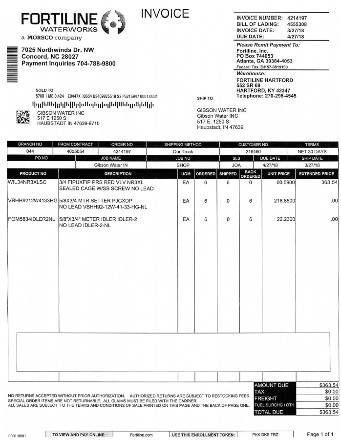

# Basic Data Extraction

Data extraction is the foundational element of document processing. **\[stuff\]**

We'll start with a simple example: a single-page invoice. Invoices are great examples because they give us a variety of values to extract: addresses, names, lists of products at different amounts. To begin, we'll use an LLM to extract four very basic elements from this document:

1.  The name of the company to remit payment to
2.  The invoice number
3.  The invoice date and due date
4.  The total amount due



## Defining an Extraction Schema

Before we start, it is always ideal to start with a mental model of *exactly what you want to extract*. We should always have a defined schema to guide the LLM on exactly what we want from the document, in what format, and the expected return value. As I explained earlier in the introduction, when processing documents for production workflows it is imperative that the return values be predictable. Unexpected return values, like income values being returned as a string ("\$6.70", "6.70", "670") instead of a float (6.70), can easily cause downstream errors. In short, we never trust the LLM to make the decision. Rather, we constrain its behavior to a narrow range of predictable parameters.

### Pydantic Schemas

[Pydantic](https://pydantic.dev/docs/validation/latest/get-started/) is extremely useful for defining extraction schemas for a number of reasons. **\[reasons\]**

OpenAI supports passing Pydantic schemas directly via its API using [structured model outputs](https://developers.openai.com/api/docs/guides/structured-outputs?api-mode=responses). Again, very useful as it requires only a small modification to the invocation code.

In Python, a very minimal extraction schema might look something like this for our scenario:

```{python}
from datetime import date

from pydantic import BaseModel, Field

class Invoice(BaseModel):
    company_name: str
    invoice_number: str
    invoice_date: date
    invoice_due_date: date
    total_amount: float
```

This simply takes our mental model of the expected output and formalizes it as an object the LLM can use to guide its extraction. In addition, we are able to take advantage of explicit type checking, to make sure that the types of values the LLM extracts are consistent with our expectations. You'll notice we map invoice number to a string rather than an int. We could just as easily do `invoice_number: int`, but the choice depends on your downstream process. Again, this is a time to emphasize that defining your schema is a crucial decision making process dictated by *how* you want to use the extracted data.

An important note: while Pydantic schemas ensure the values extracted are of the correct type, they do **not** ensure the values are strictly correct! If the LLM extracts a wrong value, or hallucinates something, Pydantic won't catch it. Validating the output of our model will be an important part of building a mature workflow.

## Invoking the LLM

After defining our schema, the next step is invoking the LLM and passing it our instructions.

For most examples in this book we'll rely on a small set of functions pre-defined in the library. This is primarily for convenience, but also because for the most part, there is nothing very fancy happening under the hood. In contrast to more conventional machine learning models where we are training models, tuning parameters, and doing data transformations, many LLM workflows are typically just finding ways to send requests to the API and parse its responses.

```{python}
from src.base import pdf_to_png, extract_from_doc
from src.utils import pretty

# define the path to the pdf we want to process
invoice_pdf = "documents/invoices/invoice_1.pdf"

# we then convert each page in the pdf to a PNG
# to facilitate conversion to a bytes object
# which we will send as a request in the API

img = pdf_to_png(pdf_path=invoice_pdf)

# now we call the wrapper function that sends a default prompt, 
# our schema, and the converted image

response = extract_from_doc(img, Invoice)

```

Let's break down the workflow above in a few steps. First, we define the location of the input file (here it is hard-coded to a single file, later on we will use some functions that will scan directories for all valid files). Then we use a function `pdf_to_png` to convert each page in the PDF to a PNG. Why? Because it has to do with how we want to send the image in the request. While OpenAI natively handles PDF uploads directly, this is not true for all LLM providers. However, image formats are more commonly available for all types of vision-capable models. Furthermore, by doing the conversion up front we control the input to the LLM, and retain the ability to modify the image prior to being processed (e.g. setting the dpi, rotating, cropping, etc...).

::: {.callout-note collapse="true" appearance="minimal"}
## Going deeper: Functions in the basic workflow

In this chapter we make use of two functions:

1.  `pdf_to_png`: this handles conversion of PDFs to PNGs
2.  `extract_from_doc`: this wraps an OpenAI invocation around some basic Pydantic workflows.

`pdf_to_png` uses the PyMuPDF library to convert each page in the PDF to a PNG bytes object. The input takes just the file path to a PDF as an input, then returns a list of PNG byte strings in page order.

``` python
def pdf_to_png(pdf_path: str) -> list[bytes]:
    """Render each PDF page as PNG bytes, in page order."""
    with pymupdf.open(pdf_path) as pdf:
        return [page.get_pixmap(dpi=150).tobytes("png") for page in pdf]
```

The invocation is handled by `extract_from_doc`. This function wraps the OpenAI `responses` API which sends the request to the OpenAI API. A few noteworthy things in this function:

-   The function takes an optional `role_prompt` parameter. The default prompt is just a bog-standard "extract info from this document" with some very limited formatting instructions to follow the schema.
-   Since `doc_imgs` comes in as a list, we need to loop through the list object and create a list of dicts where each `image_url` is converted to a base64-encoded PNG data URL. This is just to be consistent with how OpenAI expects to get image objects.
-   The actual response follows the standard flow (copy-paste from an example on OpenAI's API page). We provide the model and set the input content to our list of bytes images. More noteworthy is we make use of the `client.responses.parse` function's handling of schema objects. You can see we directly pass our schema to the `text_format` field. This enforces the output to correspond with the types defined in the schema.

``` python
def pdf_to_png(pdf_path: str) -> list[bytes]:
    """Render each PDF page as PNG bytes, in page order."""
    with pymupdf.open(pdf_path) as pdf:
        return [page.get_pixmap(dpi=150).tobytes("png") for page in pdf]


def extract_from_doc(
    doc_imgs: list[bytes], extraction_schema: type[BaseModel], role_prompt=None
):
    """Extract structured data from a multi-page document, return as JSON object"""
    client = OpenAI()

    default_role_prompt = (
        "Extract information from the attached document.\n"
        "Strictly follow the provided schema and return the data as JSON.\n\n"
    )

    # add additional instructions to default prompt header
    role_prompt = default_role_prompt + (role_prompt or "")

    # Convert all page images into a list of image content parts
    image_contents = [
        {
            "type": "input_image",
            "image_url": f"data:image/png;base64,{base64.b64encode(img).decode('ascii')}",
        }
        for img in doc_imgs
    ]

    response = client.responses.parse(
        model="gpt-6-luna",
        input=[
            {"role": "system", "content": role_prompt},
            {
                "role": "user",
                "content": image_contents,
            },
        ],
        text_format=extraction_schema,
    )

    if response.output_parsed is None:
        raise ValueError("No structured data returned")
    return response.output_parsed
```
:::

### Extracting the response

The response object comes back to us as a Pydantic object. Note: Here I am just using a utility function, `pretty()`, to format the response so it is easier to read.

```{python}
pretty(response)
```

Hmm. While we see that the extracted values for `invoice_number` and `total_amount` are correct, what happened with the dates? We can see that they are being returned correctly as `datetime.date` objects, but they contain obviously incorrect years. What's going on here?

In general, when we send a prompt to an LLM without specific instructions

Let's try this again, making some minor modifications to our schema.

```{python}

class InvoiceWithAnnotations(BaseModel):
    company_name: str = Field(description="Name of company to remit payment to")
    invoice_number: str = Field(description="The invoice number")
    invoice_date: date = Field(description="The date the invoice was issued in format YYYY-MM-DD")
    invoice_due_date: date = Field(description="The date the invoice is due in format YYYY-MM-DD")
    total_amount: float = Field(description="The total amount due of the invoice")
```

The new schema adds field descriptions, which are a part of the Pydantic `BaseModel`. For our purposes these are instructions which the LLM will see as it processes the schema in the invocation. These small hints help instruct the model on what it should be looking for on the document. With smaller, less-intelligent models, nudges toward the right values can often make a big difference. For example, we explicitly tell the LLM that dates of the invoice should be returned as `YYYY-MM-DD`. On the document they are in `MM/DD/YY`, which may cause some confusion in how it is extracted.

Running this again, and just swapping out the new schema, we see that we now get the expected values:

```{python}
response = extract_from_doc(img, InvoiceWithAnnotations)
pretty(response)
```

### Expanding schemas with nested responses

In the last two examples we've built a schema from the ground-up by defining the names, types, and descriptions of the fields to be extracted. The previous examples have been simple, because they've all relied on extraction of a single field with one value. However, what happens if we want to extract something like this below:

**\[stuff\]**

To cover this, we can use a nested field in our extraction schema. It is good practice to work from the ground-up, so we first define the lowest-level element that we want to extract. Here, it is two specific paired values: (1) the product number on the invoice and (2) the text description of the item.

Translating this to Pydantic we can see below that we define this first as a single `ItemDescription` object, then add a new extraction field to `InvoiceWithAnnotations` that returns a `list[ItemDescription]`. Hence, the nesting we described above.

```{python}

# this defines a single item description
class ItemDescription(BaseModel):
    product_number: str
    description: str

# this extracts a list of item descriptions, as defined above
class InvoiceWithAnnotations(BaseModel):
    company_name: str = Field(description="The name of the company filing the invoice")
    invoice_number: str = Field(description="The invoice number")
    invoice_date: date = Field(description="The date the invoice was issued in format YYYY-MM-DD")
    invoice_due_date: date = Field(description="The date the invoice is due in format YYYY-MM-DD")
    total_amount: float = Field(description="The total amount of the invoice")
    item_description: list[ItemDescription] = Field(description="Product number and description of each item")
```

Running this with our updated schema, we see that the LLM now returns the requested items as a list of dicts:

```{python}

# re-run with the updated invoice
invoice = extract_from_doc(img, InvoiceWithAnnotations)
pretty(invoice)

```

### Changing extraction via prompt only

The method I have outlined above is the one I prefer for strict extraction tasks. As much as possible I tend to keep the system prompt minimal and focused strictly on document-wide rules (e.g. always extract dates as `YYYY-MM-DD`). Under-the-hood, when we pass our schema object to the `responses` API, it essentially converts it to a "prompt" that the LLM follows similar to a purely text-based one (a bit of an oversimplification here, but the OpenAI guide on the [Structured Outputs API](https://developers.openai.com/api/docs/guides/structured-outputs?api-mode=responses) can help).

In our very first example we saw that with very minimal instructions the LLM failed to capture the dates correctly because it did not have enough context to parse them. We solved that by adding an annotation to the field description to only extract dates as `YYYY-MM-DD`. In a way, this is roughly equivalent to adding an instruction to the prompt:

```{python}
# Add an instruction to the role prompt on date formatting
# use the original, limited Invoice object with no annotations
invoice = extract_from_doc(img, Invoice, role_prompt="Return all dates in the format YYYY-MM-DD")
pretty(invoice)
```

So which is better? In some ways, you will have to experiment with your projects, and will depend on the type of model you are using. Some are more adept at following instructions in a schema format ([NuExtract](https://about.nuextract.ai/) for example is a small VLLM fine tuned on JSON schemas). From a conceptual perspective I tend to prefer to keep instructions for each field close to where it is defined, and use the system role to guide overall tasks on the document. In my experience I have found the LLM will often drift "less" from the instructions when they are formatted this way. However, your mileage may vary and I would encourage you to try different variations if you find one is not working as expected.

## Summing it all up

Here's a few bullets on what we covered in this chapter

-   Define the fields you want before sending a document to the model. A Pydantic schema gives each field a name and type.
-   Render PDF pages as images and send them to a vision-capable model. The helper functions keep those preparation steps out of the main example.
-   Use the parsed result as a Python object, then compare important values with the source document. A value can have the right type and still be wrong.
-   Add field descriptions when a field needs more context, and check whether they improve the result on your examples.

## Extra practice

Use the same workflow defined above, and make some changes to the schema to do the following:

1.  Instead of extracting `total_amount`, create a nested extraction field to extract all values that sum to the total due (amount due, tax, freight, fuel surcharge).
2.  Update the `ItemDescription` object to also return the `unit_price` and `extended_price` of each element as a float.
3.  Add a new extraction field to the existing schema. Try three versions: one with no instructions, one with a Pydantic description field, and one with a prompt instruction. Do you see any differences?