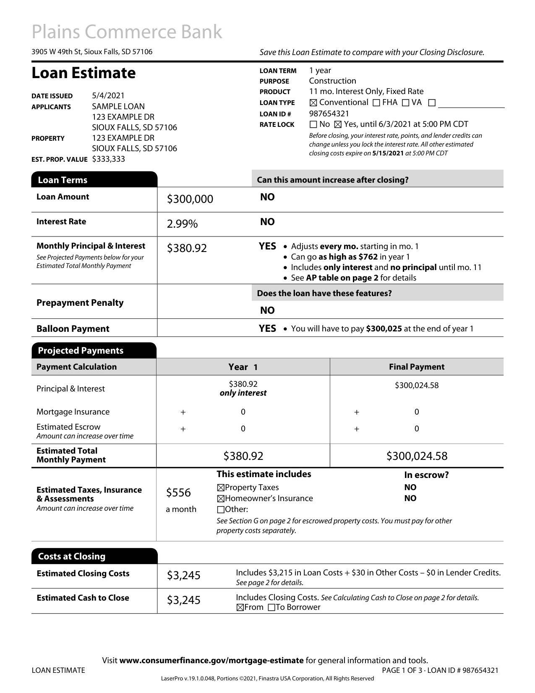
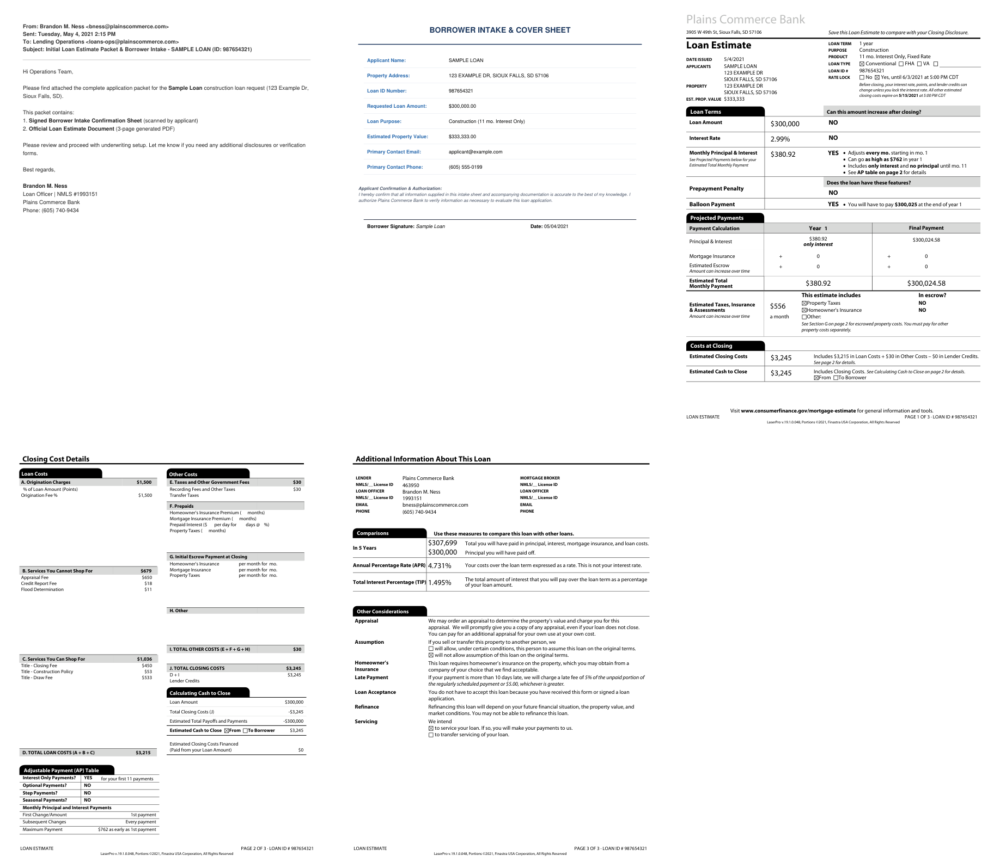

# Classification & Segmentation

In the first chapter we covered basic data extraction, which is the foundational piece of document analysis. In this chapter we'll generalize the extraction logic to classification. When we say 'classification' we're referring to applying a label to a single page of a document, or to the whole packet. Classification can be useful because it can be used to help segment a single document into discrete pieces. These pieces can then be routed to separate downstream tasks. For example, see a hypothetical process below where a single document results in multiple tasks: 

```{mermaid}
flowchart LR
    classDef doc fill:#f2f3f5,stroke:#BBBBBB,stroke-width:2px,color:#222222
    classDef classify fill:#e8f4f8,stroke:#4477AA,stroke-width:2px,color:#1e3a5f
    classDef routeA fill:#fdf8e4,stroke:#CCBB44,stroke-width:2px,color:#4a4208
    classDef routeB fill:#f7edf3,stroke:#AA3377,stroke-width:2px,color:#471432
    classDef routeC fill:#eaf4ec,stroke:#228833,stroke-width:2px,color:#123d19
    classDef extract fill:#ebf7fc,stroke:#66CCEE,stroke-width:2px,color:#144659
    classDef alert fill:#fdecee,stroke:#EE6677,stroke-width:2px,stroke-dasharray:4 3,color:#5c1720

    Doc["[Pages 1-12 · Multi-Page PDF]<br/>Mixed Document Packet"]
    Split{{"Classifier & Splitter<br/>Boundaries & Doc Types"}}

    Doc ==> Split

    subgraph Segments ["Classify & Segment"]
        direction TB
        P1(["Part 1 · pp. 1-4<br/>Invoice"])
        P2(["Part 2 · pp. 5-6<br/>ID / License"])
        P3(["Part 3 · pp. 7-12<br/>Contract Addendum"])
    end

    Split --> P1
    Split --> P2
    Split --> P3

    subgraph Extractors ["Document Extraction"]
        direction TB
        E1["Invoice Schema<br/>Line Items, Tax, Vendor"]
        E2["ID Schema<br/>Name, ID #, Expiry"]
        E3["Legal Schema<br/>Clauses, Dates, Signers"]
    end

    P1 --> E1
    P2 --> E2
    P3 --> E3

    E1 --> D1[("AP / ERP<br/>Ledger")]
    E2 --> D2{"KYC Check<br/>Passed?"}
    E3 --> D3[("Clause<br/>Repository")]
    E3 -. Low Confidence .-> D4[/"Human Review<br/>Queue"\]

    class Doc doc
    class Split classify
    class P1,D1 routeA
    class P2 routeB
    class P3,D3 routeC
    class E1,E2,E3 extract
    class D2 classify
    class D4 alert

    style Segments fill:#ffffff,stroke:#BBBBBB,stroke-width:1.5px,stroke-dasharray:4 4,color:#444444
    style Extractors fill:#ffffff,stroke:#BBBBBB,stroke-width:1.5px,stroke-dasharray:4 4,color:#444444

```

While we'll eventually get to multi-step workflows, for this chapter we'll focus narrowly on the classification and segmentation steps.

## Classifying a Single Page

We'll start with the simplest possible example: classifying a single document from a list of pre-defined categories. Below, we see a single loan document as our input. While this example is a bit simple, we might imagine a business use-case where individual pages are ingested into a system and we need to label them to route to a specifc location, or to a different workflow. As I stated above, classification is typically an intermediate step to either route a document somewhere, or to apply a specific set of tasks to it.



With this in mind, we can recycle a significant portion of our workflow from the previous chapter on data extraction. In fact, one might argue that a classification label is just another piece of information being "extracted" from the document. From a workflow perspective I treat classification no different than a pure extraction task. The primary difference here is that instead of extracting specific values from the document, we instruct the LLM to give its best guess on what pre-defined category the document likely falls into. 

While we are only going to classify a single loan document above, for argument's sake, lets assume some valid types might be: 

  1. Printed emails 
  2. Scanned intake documents
  3. Loan documents
  4. Invoices

In addition, to be safe, we will also want to include an "other" category. Adding a fallback category is especially important for labeling tasks, because if the LLM sees something that doesn't cleanly fall into an accepted category, we don't want it to do choose an obviously wrong label or hallucinate unusual output. Below we have some code that takes these broad labels and translates them into Pydantic for our classification schema:

```{python}
from enum import Enum
from src.base import pdf_to_png, extract_from_doc
from src.utils import pretty

from pydantic import BaseModel, Field

# this gives the LLM a constrained list of possible values to return
class PageCategory(str, Enum):
  PRINTED_EMAIL = "Printed Email"
  SCANNED_INTAKE = "Scanned Intake Sheet"
  LOAN_DOCUMENT = "Loan Document"
  INVOICE = "Invoice"
  OTHER = "Other Document Type"

# ...and we pass it to our `PageType` extraction class
class PageType(BaseModel):
  page_type: PageCategory = Field(description="One of the allowed page types")
  reasoning: str = Field(description="Reasoning for the page type classification in under 15 words")
```

To start, we'll do all our imports and define a `PageCategory` as a collection of `Enum` values[^doc-classification-1]. Using Enums is a convenient way to pass structured labels to the LLM through Pydantic because it enforces the label types. Without enforcing return types it is not impossible that the LLM might return the classification for "Loan Document" like:

[^doc-classification-1]: An `Enum` is just a python base class that binds a value to an alias (e.g: `RED = 1` or `OTHER = "Other Document Type"`)

-   loan document
-   LOAN DOCUMENT
-   loan_document

All of which could break a downstream process expecting to see a specific label. With the recent improvement in model performance, this has become less of a concern than perhaps a year ago, but there is no reason to risk it. In circumstances where an invalid value might break something, we *never* want the LLM to even have the option to guess at the label type. We should always enforce a list of return values for a classification task and catch any bad values before they enter the workstream.

We see that this `PageCategory` class is the value type for the classification schema. Specifically, we define a `page_type` classification as one of the allowed values from a `PageCategory` class. You'll also notice I include a free-text `reasoning` field. While these aren't especially useful in a production workflow, I do often find these useful for debugging, as they give the LLM a spot to identify specific elements that led to its classification. Reasoning fields can help refine your prompts later if it looks like the LLM is getting some types of documents confidently wrong.

With this in mind, we can run the classification workflow using the exact same pipeline from the previous chapter. Since the `extract_from_doc` function only requests an input image and an extraction schema, it is easy to generalize different processes based only on the schema.

```{python}
img = pdf_to_png("documents/loans/loan_document_1.pdf")
page_classifier = extract_from_doc(img, PageType)
pretty(page_classifier)
```

Voila! We can see that the output matches our schema. The `page_type` classification is an `enum` that gets returned with a name and value. Depending on your downstream process you can access the label directly by accessing the `.value` parameter:

```{python}
page_classifier.page_type.value
```

## Segmenting a Document

The example above is useful, but a little too simplistic. While there are circumstances where the input might always be a single document, most real-world scenarios often have documents submitted as a mixed packet of documents in a single attachment. As an example, you mind find yourself processing documents that derive from email and contain multiple attachments along with the original email message. In many cases perhaps only one page of the attachment may actually be needed for your process. Expanding the single page above, here's a multi-page example with a variety of documents:



### Segmentation Logic

So, in this case we have an email message, a scanned intake sheet, and three pages of loan documents. For processing, it is highly likely that maybe only one or two pages of this attachment are actually useful. You can imagine a scenario where we only need the LLM to extract the loan information from the third page, and maybe the sender's information from the email page. There is an argument here that you could just make a giant single-pass prompt that instructs the LLM to look at all the pages and figure it out on its own. In my experience, that is typically a *bad* idea. Let me explain why:

1. Single-pass prompts create a bloated set of instructions that end up having to account for tons of edge cases ("If it's an email, do X; if it's an intake sheet, ignore Y; if it's a promissory note, extract Z"). The more rules you add, the less reliable the process is. 
2. Small changes to a monolithic prompt can affect other unrelated pieces. 
3. From a cost perspective, it is also wasteful if you end up passing a more complex extraction task across potentially many irrelevant pages. You can use a cheaper model for the classification and route to a more expensive one for the harder tasks.

Hence my argument for segmentation. If we instead break the input into smaller sub-tasks, it makes the process more reliable, easier to debug, and easier to expand. When reliability is key, break your tasks down.

### Expanding a schema to segmentation

Updating the schema for segmentation is actually pretty straightforward. Here we update our `PageType` class to also return a list of pages as `list[int]`. Then, since we are iterating over an entire document, we get our document segments as a list of page types: `list[PageType]`. Its Pydantic, all the way down.

```{python}
# update PageType to also return relevant page numbers
class PageType(BaseModel):
  page_type: PageCategory = Field(description="One of the allowed page types")
  reasoning: str = Field(description="Reasoning for the page type classification in 10 words or less")
  pages: list[int] = Field(description="Page number(s) assigned to this page type, indexed from 1")

# wrap a single page type as an element of `segments`, which is a list
class DocumentSegmentor(BaseModel):
    segments: list[PageType] = Field(description="List of page type segments in the document")

# run and extract
img_packet = pdf_to_png("documents/loans/loan_packet_1.pdf")
document_segmentor = extract_from_doc(img_packet, DocumentSegmentor)
pretty(document_segmentor)

```

## Summing it all up

In this chapter we expanded document processing

## Extra practice